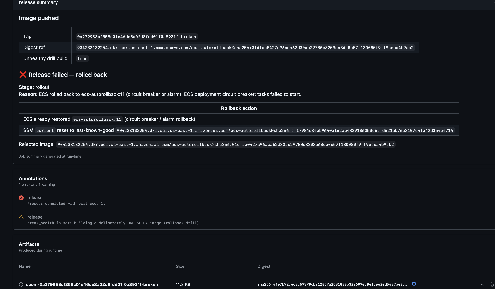
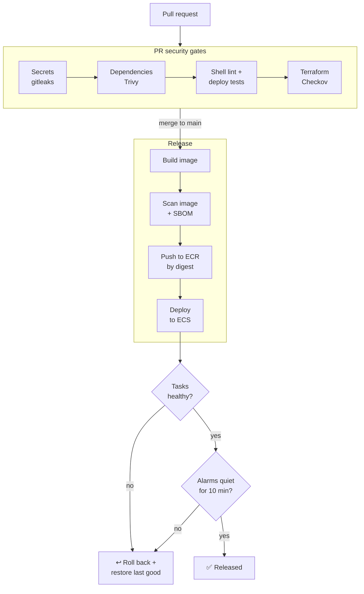
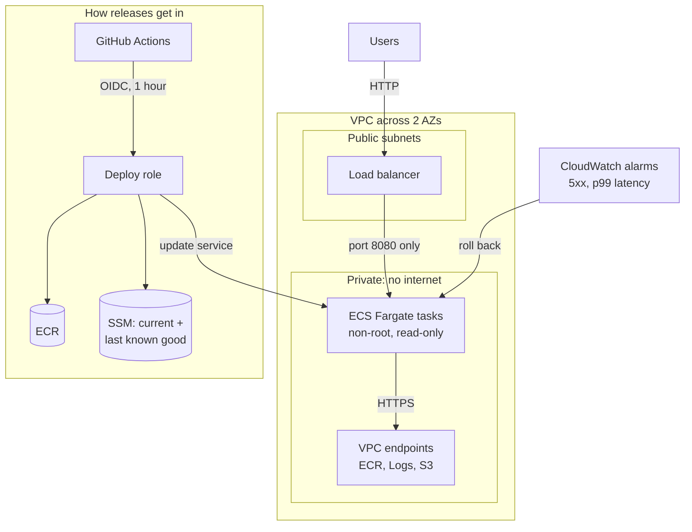
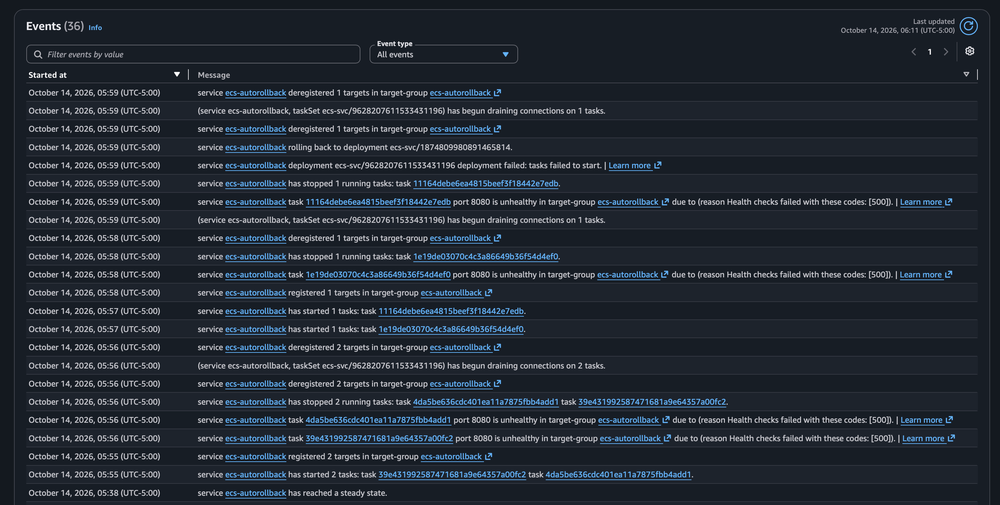
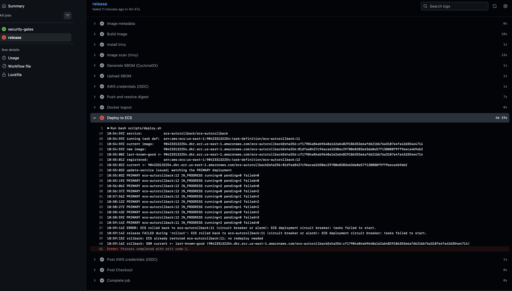
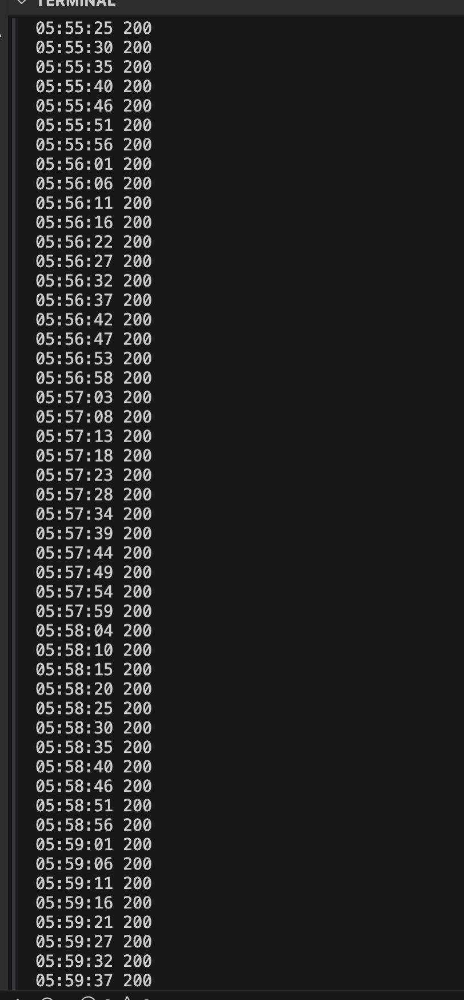
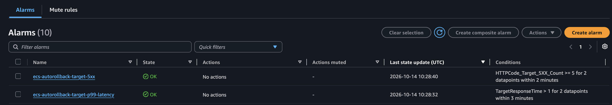

# ECS DevSecOps Pipeline with Automatic Rollback

A small Flask app deployed to AWS ECS Fargate by a GitHub Actions pipeline that
**checks every change for security problems** and **undoes a bad release on its
own**, without anyone getting paged.

I proved it works by shipping a deliberately broken release. The pipeline
caught it, ECS rolled it back, and the site never returned a single error.



---

## How it works, in one picture



Pull requests only run the security gates. Only `main` can release, and nothing
deploys unless every gate passes.

## What runs in AWS



The containers can't reach the internet at all. They pull images and send logs
through private VPC endpoints, so a compromised container has nowhere to call
home to.

---

## Security gates

Every pull request has to pass all of these before it can merge.

| Gate | What it catches | Tool |
|---|---|---|
| Secrets | API keys, passwords, tokens anywhere in git history | gitleaks |
| Dependencies | Known vulnerabilities in Python packages | Trivy |
| Shell scripts | Bugs and unsafe patterns in the deploy script | shellcheck |
| Deploy logic | Rollback still works (5 scenarios, mocked AWS) | custom test suite |
| Infrastructure | Insecure Terraform (open ports, missing encryption, etc.) | Checkov |
| Rollback policy | An ECS service that can't roll itself back | custom Checkov rule `CKV_IKE_ECS_1` |

And at release time:

| Gate | What it catches |
|---|---|
| Image scan | Fixable HIGH/CRITICAL vulnerabilities or secrets inside the image. Runs **before** the push, so a bad image never reaches the registry. |
| SBOM | A full list of what's in the image, saved with every build |

## Four layers of rollback

Each layer catches a different kind of failure.

| # | Layer | Catches | Who acts |
|---|---|---|---|
| 1 | **Circuit breaker** | New tasks crash or fail health checks | ECS |
| 2 | **Alarm rollback** | Real traffic gets 5xx errors or slows down *during* the deploy | ECS + CloudWatch |
| 3 | **Bake window** | The same alarms firing in the 10 minutes *after* the deploy | `deploy.sh` |
| 4 | **Rollback handler** | Anything else goes wrong, or the run is cancelled. Puts the old version back and resets SSM to the last good image. | `deploy.sh` |

### The gotcha that makes this work

The usual way to wait for an ECS deploy is `aws ecs wait services-stable`.
**It lies after a rollback.** When the circuit breaker restores the old version,
the service *is* stable again, just on the old code. The waiter reports
success and your pipeline goes green on a failed release.

`deploy.sh` instead watches which version the service's main deployment is
running. If it switches away from the new one, that's a rollback, and the job
fails.

---

## The rollback drill

To prove it, I ran the pipeline with a `break_health` switch that builds an
image whose `/health` endpoint returns 500.

**What happened:**

1. The broken image passed the scans and deployed as revision 12.
2. Its tasks failed health checks with 500s.

   

3. After 3 failed tasks (about 4 minutes), the circuit breaker rolled back to revision 11.
4. `deploy.sh` saw the switch, failed the job, and reset SSM to the last good image.

   

5. **The site stayed up the whole time.** A request every 5 seconds got `200`
   throughout, and AWS recorded 0 errors and 2 healthy targets every minute.

   

The rollback alarms never fired, which is correct: the broken tasks never
received real traffic, so layer 1 handled it before layers 2 and 3 were needed.



---

## Security choices worth calling out

- **No AWS keys anywhere.** GitHub gets a 1-hour session through OIDC. The role
  trusts only this repo's `production` environment, matched by GitHub's
  immutable repo ID, so a renamed or re-created repo with the same name can't use it.
- **Least-privilege deploy role.** It can push to one ECR repo, update one ECS
  service, and write two SSM parameters. It can't change infrastructure. Every
  statement was reviewed and checked with IAM Access Analyzer (0 findings).
- **Everything pinned.** GitHub Actions by commit SHA, the base image and
  Dockerfile frontend by digest, Python packages by hash, and scanner binaries
  by checksum.
- **Hardened container.** Runs as user 10001 with a read-only filesystem, all
  Linux capabilities dropped, and no pip at runtime.
- **Locked-down network.** Tasks only accept traffic from the load balancer. VPC
  endpoint policies only allow this account and the exact API calls the tasks need.
- **Protected `main`.** Signed commits, required checks, squash-only merges,
  no force pushes.
- **Remote state.** Terraform state lives in an encrypted, versioned S3 bucket
  and is never committed.

## What I tested

| Test | Result |
|---|---|
| Fake secret committed in a PR | gitleaks failed the PR ✅ (GitHub push protection also blocked a fake AWS key) |
| Known-vulnerable Python packages | Trivy blocked them ✅ |
| ECS service without rollback | Custom Checkov rule failed it, in 4 different ways ✅ |
| Deploy script, 5 scenarios against mocked AWS | Success, circuit breaker, alarm during bake, missing alarm, cancelled run ✅ |
| Breaking the SSM reset on purpose | The test suite caught it ✅ |
| Real broken release (the drill) | Rolled back, zero downtime ✅ |

## Things that broke along the way

Real problems I hit and fixed, each in its own PR:

- **OIDC login was refused.** GitHub now puts the repo's numeric ID in the
  token. I updated the trust policy to match, which is also more secure.
- **The first real deploy crashed.** Fargate mounts `/tmp` as root-only, so the
  non-root app couldn't write to it. It worked locally because Docker's tmpfs
  is world-writable. The circuit breaker rolled it back, which made it a
  real-world test of layer 1 before the drill.
- **Renaming security groups took the site down for ~15 minutes.** Terraform
  deletes the old group before creating the new one, but AWS won't delete a
  group that's in use. Fixed with `create_before_destroy`.
- **Cancelling a run would have skipped the rollback.** The wait loop ran in a
  subshell, which delays signal handling until it finishes, and GitHub kills a
  cancelled job after about 10 seconds. The handler now runs immediately, and
  a test checks it.

---

## Run it yourself

**You need:** an AWS account, Terraform 1.10+, the AWS CLI, the GitHub CLI, and an S3 bucket for Terraform state.

1. **Configure.** Copy `terraform/terraform.tfvars.example` to
   `terraform/terraform.tfvars` and fill in your values. Set your state bucket in
   `terraform/versions.tf`.
2. **Create the infrastructure.**
   ```bash
   cd terraform
   terraform init
   terraform apply
   ```
3. **Connect GitHub.** Create a `production` environment in the repo
   (deployments from `main` only) and add each value from
   `terraform output github_environment_variables` as an environment variable.
4. **Deploy.** Push to `main`, or run the workflow from the Actions tab.
5. **Try the drill.** Run the workflow with `break_health` ticked.

**Cost:** about $78/month while running, mostly the VPC endpoints (~$44), the
load balancer (~$16), and Fargate (~$18). Tear it down with `terraform destroy`
when you're done; empty the ECR repo first, because it refuses to delete
images on purpose.

## Before real production

Honest gaps, mostly skipped for cost:

- **HTTPS.** The code is ready, but it needs a registered domain and certificate. Today it's HTTP only.
- **WAF** in front of the load balancer.
- **Load balancer access logs.**
- **Image signing and provenance** (e.g. cosign), verified before deploy.
- **Customer-managed KMS keys** instead of AWS-managed ones.
- **Dependabot** to keep the pinned SHAs and digests up to date.
- **A staging environment** that gets the same image digest before production.
- **Unfixed CVEs.** Amazon Inspector reports 3 HIGH issues in Debian's glibc and zlib with no fix released yet. The next build picks up fixes automatically once they ship.

Every Checkov finding I accepted has a written reason next to the code.

## Repo layout

```
app/                   Flask app + hardened Dockerfile
terraform/             VPC, endpoints, ALB, ECS, alarms, OIDC role
scripts/deploy.sh      Deploy, bake window, rollback handler
scripts/tests/         Deploy tests with a mocked AWS CLI
policies/checkov/      Custom rollback policy + its tests
.github/workflows/     The pipeline
docs/images/           Drill screenshots
```
